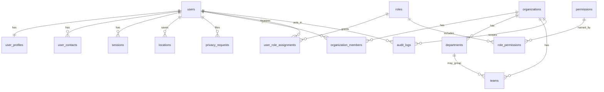

# Data model

This describes the single database that is running today. Target ownership is one database per service, in [target services](target-services.md). No migration in this document has been applied.

PostgreSQL is the source of truth. Stage 1 creates the identity, tenancy, audit, and outbox tables below. Issue, incident, resolver, and assignment tables are specified for later stages and are not in the database yet.

Keys are UUIDs. Category-specific attributes are not stored yet; when they arrive they belong in versioned JSONB, not in Go enums. Media bytes will live in object storage. This stage stores no media.

## Stage 1 relationships

`user_role_assignments.organization_id` is null for a platform role and set for an organization-scoped role. Two partial unique indexes enforce that. A global `org_admin` assignment is not created for a demo organization owner; that role is scoped to the organization. Global permissions are loaded only from rows where `organization_id` is null. Membership, not a global role, authorizes organization management.

## Identity and tenancy

| Table | Purpose |
| --- | --- |
| `users` | Email, password hash, phone, status, lockout counters, `is_demo` |
| `user_profiles` | Display name, language, notification and privacy preferences |
| `user_contacts` | Email or phone contact rows |
| `sessions` | Hashed refresh token, family, expiry, revocation, replacement |
| `otp_challenges` | Hashed code, purpose, attempts, expiry, consumption |
| `roles`, `permissions`, `role_permissions` | Stable role and permission catalogue |
| `user_role_assignments` | Global or organization-scoped grant |
| `organizations` | Tenant. `id` is the tenant id |
| `organization_members` | owner, admin, member, or field_worker |
| `departments`, `teams` | Structure inside one tenant |
| `locations` | Saved places. Geography is set only when both latitude and longitude were supplied |
| `idempotency_keys` | Register replay for the same body hash |
| `audit_logs` | Actor, action, resource, tenant, request id, metadata |
| `outbox_events` | Unpublished domain events |
| `privacy_requests` | Deletion, export, or correction request. Deletion does not erase the user |
| `feature_flags` | `org_self_service`, `otp_login`, `ai_intake` |
| `schema_migrations` | Applied SQL versions. The application role cannot change this table |

`locations.geom` is a `geography(Point, 4326)` with a GiST index. An address-only place leaves `geom`, `latitude`, and `longitude` null. The source is one of `user_gps`, `user_pin`, `user_address`, or `user_locality`.

## Row-level security

Policies are forced on the tenant and user tables. Helper functions:

- `app_user_id()` reads `app.user_id`.
- `app_flag(text)` is true when that setting is `on`.
- `app_is_org_member` and `app_is_org_manager` are security definer and can see membership without exposing other users' profile rows.
- `app_user_id_by_email` resolves a member invite without a blanket user read.
- `app_org_member_directory` returns the member list to a manager.

`INSERT ... RETURNING` also checks the SELECT policy. Creating an organization therefore inserts a known id and does not return the row until the owner membership exists. See [ADR 0001](../decisions/0001-foundation.md).

Anyone who can execute SQL as `lokasolve_app` can set the same custom variables. That password is an application secret. Superusers bypass row-level security, so the API refuses to use one.

## Not created yet

These names are the target model. They are not tables in migration `0001_identity.sql`: issues, issue attributes and media, incidents, incident reports, resolvers, assignments, quotations, resolutions, conversations, notifications, AI runs, knowledge chunks, webhook events, and integration accounts. pgvector is also not installed.
