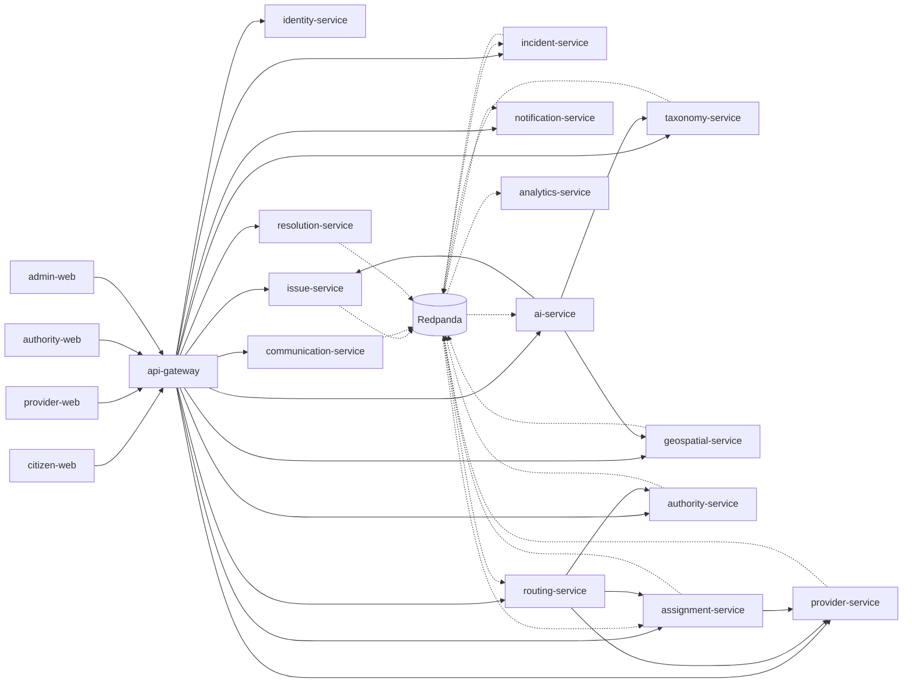

# Target services

Approved by [ADR 0002](../decisions/0002-independent-services.md). This is the target. The running process is still the one described in [system architecture](system-architecture.md).

## Dependency diagram

Synchronous calls go left to right through the gateway. Events flow on the bus after a service commits its own write. A solid arrow is HTTP. A dotted arrow is an event the consumer may ignore until it is ready.



Login and report creation do not wait on the bus. The AI service recommends. Routing and authority services decide.

## Repository map

Each name is a future Git repository. Creating one requires an implementation instruction. The current folder `D:\LokaSolve` remains the migration source until its routes have moved.

| Repository | Runtime | Owns | First release |
| --- | --- | --- | --- |
| lokasolve-infrastructure | Compose, later deploy charts | Local wiring, image tags, secret references | Yes |
| lokasolve-api-contracts | OpenAPI, AsyncAPI, JSON Schema | Published contracts only | Yes |
| lokasolve-api-gateway | Go | Public HTTP, rate limits, token check, request ids | Yes |
| lokasolve-identity-service | Go | Accounts, sessions, roles, organizations | Yes |
| lokasolve-issue-service | Go | Reports, report media keys, report timeline | Yes |
| lokasolve-citizen-web | Next.js | Resident UI | Yes, after the gateway route is stable |
| lokasolve-taxonomy-service | Go | Categories, problem types, intake schemas | Second extraction |
| lokasolve-geospatial-service | Go, PostGIS | Boundaries, geocodes, nearby queries | Second extraction |
| lokasolve-incident-service | Go | Master incidents and report links | Second extraction |
| lokasolve-authority-service | Go | Offices, channels, jurisdictions, escalation policy, referrals | Second extraction |
| lokasolve-routing-service | Go | Eligibility decisions and explanations | After authority and provider data are reachable |
| lokasolve-assignment-service | Go | Offers, allocation, acceptance, scheduling, dispatch, work progress | Provider-network stage, after routing |
| lokasolve-provider-service | Go | Provider profiles, verification, skills, qualifications, coverage, availability, reputation | Provider-network stage, not the first deployment |
| lokasolve-resolution-service | Go | Evidence decisions, confirm, dispute, reopen | After assignment |
| lokasolve-notification-service | Go | In-app notices and preference checks | Third extraction |
| lokasolve-communication-service | Go | Email, WhatsApp, SMS, portal adapters | Third extraction, adapters off |
| lokasolve-ai-service | Python, LangGraph | Agent runs and recommendations | After issue and taxonomy APIs exist |
| lokasolve-analytics-service | Go | Read models and metrics | After events exist |
| lokasolve-provider-web | Next.js | Provider UI | After the provider and assignment APIs exist |
| lokasolve-authority-web | Next.js | Office and officer UI | After authority API exists |
| lokasolve-admin-web | Next.js | Operations UI | After identity and issue APIs exist |

Profile stays in the identity service. There is no profile repository.

Until the provider-network stage, provider master data remains in the current process. The assignment service, once extracted, stores `provider_id` and reads profile, skills, coverage, and availability through the provider API. It never writes those rows.

## Database ownership

One Postgres server in local development. Separate database and login per service. No shared schema. No foreign key across databases. Cross-service links are identifiers plus an event or API check.

| Database | Writer | Tables it owns |
| --- | --- | --- |
| identity | identity-service | users, credentials, sessions, roles, grants, organizations, departments, memberships, profiles, saved places |
| issue | issue-service | reports, report_events, media_keys, consent records on the report |
| taxonomy | taxonomy-service | categories, problem_types, intake fields, schema versions |
| geospatial | geospatial-service | localities, boundaries, geocode cache, spatial indexes |
| incident | incident-service | incidents, incident_report_links, merge and split history |
| authority | authority-service | authorities, channels, jurisdictions, escalation steps, referrals, referral events |
| routing | routing-service | routing decisions, candidate scores, policy version used |
| provider | provider-service | provider profiles, verification records, skills, qualifications, coverage, availability, reputation |
| assignment | assignment-service | offers, allocations, acceptance, schedules, dispatch records, work progress. `provider_id` is a reference, not a foreign key |
| resolution | resolution-service | resolution decisions, disputes, closure |
| communication | communication-service | outbound attempts, provider ids, delivery evidence, opt-out |
| notification | notification-service | in-app notices, templates, read state |
| ai | ai-service | run metadata, model version, tool trace, evaluation scores. No report body archive beyond what a run needs |
| analytics | analytics-service | projections and aggregates rebuilt from events |

The issue service may store a report's latitude and longitude as the user supplied them. The geospatial service is the only service that computes nearby, boundary, and jurisdiction geometry.

Until the taxonomy extraction, the issue database also holds the category tables. That is a temporary ownership, recorded in the migration plan, not the target.

## API and events

HTTP is for commands and queries the caller is waiting on. Events are for facts other services may react to.

Every public HTTP contract lives in `lokasolve-api-contracts` and is versioned under `/v1`. A breaking change is a new major version. Additive fields are allowed.

Every event has `event_id`, `event_type`, `schema_version`, `occurred_at`, `producer`, `correlation_id`, `causation_id`, and a small payload. Tenant or organization id is included only when the fact is tenant-scoped.

The producer writes the event to its own outbox table in the same transaction as its state change. A publisher process sends the outbox to Redpanda and then marks it published. Consumers store `event_id` and ignore duplicates. A failed consumer retries with backoff. A poison message goes to a dead-letter topic for that consumer. Replay reads the log again. It does not write the producer's database.

These events are enough for the first extractions:

| Event | Producer | Consumers that may care |
| --- | --- | --- |
| account.registered | identity | analytics |
| report.created | issue | incident, notification, ai, analytics |
| report.classified | issue | routing, analytics |
| incident.linked | incident | notification, analytics |
| authority.matched | authority | routing |
| referral.prepared | authority | notification |
| referral.status_changed | authority | notification, analytics |
| provider.verification_changed | provider | routing, assignment, analytics |
| provider.availability_changed | provider | routing, assignment |
| assignment.offered | assignment | notification |
| assignment.status_changed | assignment | resolution, notification |
| message.status_changed | communication | notification, analytics |
| resolution.decided | resolution | incident, analytics |

Login, token refresh, and report reads do not publish events and do not read the bus.

## Gateway and authentication

```text
Browser or service
  -> gateway
       checks access-token signature, issuer, expiry, and audience
       strips any client-supplied subject, role, or tenant header
       sets X-Request-Id and X-Subject from the token
  -> owning service
       calls identity if it needs roles or jurisdiction
       applies its own object check
```

The refresh cookie stays on the web origin. The gateway does not see it. The web app exchanges the cookie with the identity service through a narrow route.

Service-to-service calls use a separate credential from human tokens. A human token is never reused as a service credential.

The current token rules stay: no roles, email, or tenant id inside the access token. Identity is queried, or it issues a short-lived authorization response for one action.

## Authorization

A role name is not enough. The service that owns the row checks:

- the subject is authenticated
- the permission exists on a grant
- the grant's organization matches when the row is tenant-scoped
- the grant's jurisdiction covers the row when the row is geographic
- the subject owns the row, or is assigned to it, when the action is personal or field work

Target grants, mapped from what the product needs. Codes already stored in the current database are not renamed until the identity extraction.

| Actor | May do | May not do |
| --- | --- | --- |
| Resident | Create and read own reports, consent to a packet, confirm or dispute own outcome | Read another resident's private report, assign work, verify an office |
| Provider | Read and update work offered to that provider | Read another provider's work, see a reporter phone number unless the report allowed it |
| Organization admin | Manage own organization membership | Read another organization's cases |
| Government officer | Read and act on referrals in the officer's department and jurisdiction | Read another department, or mark a message delivered without channel evidence |
| Field worker | Update an assignment assigned to that worker | Open unassigned reports |
| Support agent | Read accounts and audit needed for a request | Change routing policy or grants |
| Auditor | Read scoped audit | Change business rows |
| Super admin | Grants, taxonomy publish, integration switches | Skip consent, or invent an official reference |

Public nearby views return locality and a short summary. They do not return reporter name, phone, exact address, or exact coordinates.

## Authority and escalation

The authority service owns offices, official channels, jurisdiction links, and escalation policy. A channel has a type, a purpose, a verification source, a review date, and a status of `pending`, `verified`, or `unavailable`. Unverified channels cannot be selected for automated send.

A referral is a separate record from the report, the incident, and the assignment. Its states stay distinct:

`drafted`, `consented`, `approved_for_submission`, `sent`, `provider_accepted`, `delivered`, `acknowledged`, `officially_registered`, `department_assigned`, `action_started`, `resolution_reported`, `confirmed`, `closed`, plus `failed`, `rejected`, `not_supported`, `manual_handoff`, `unknown`, and `retrying`.

Only the communication service may set `sent`, `provider_accepted`, or `delivered`, and only from provider evidence. `officially_registered` requires an external reference received from the office or its portal, stored with the evidence id. An operator typing a number is recorded as operator-entered evidence, not as a portal receipt.

Escalation follows configured steps for that office and category. Each step has a condition, a timer, a target office, and whether a person must approve. The service queues the next step. It does not message every higher office. If no step exists, the referral stays in review.

No adapter sends mail, WhatsApp, SMS, or a government form until that adapter's credentials and approval are explicitly enabled.

## AI integration

The AI service is called by the issue service after a report is stored, or it consumes `report.created`. The report response does not wait on a model.

LangGraph owns intake, classification, location clarification, correlation hints, severity hints, authority and provider recommendations, message drafts, and evidence review. Each node returns a schema with a confidence and a provenance field. Missing location stays missing. Low confidence creates a review request through the owning service's API.

The AI service has no tool that writes referral status, assignment status, or message status. Those writes belong to authority, assignment, and communication.

Until a model provider and an evaluation set are approved, the graph runs the deterministic rules that already exist and labels them as rules.

## Minimum first release

The smallest deployable set that preserves registration and reporting:

1. `lokasolve-infrastructure` starts the current process plus gateway dependencies.
2. `lokasolve-api-contracts` publishes the auth and report routes the gateway forwards.
3. `lokasolve-api-gateway` forwards `/v1/auth/*`, `/v1/me/*`, and `/v1/issues/*` to the current process.
4. The current Next.js app keeps its screens and calls the gateway instead of the Go port directly.

Identity and issue become their own processes only after that forward path is proven. Taxonomy, geospatial, incident, authority, routing, assignment, provider, resolution, notification, communication, AI, and analytics stay inside the current process until their extraction phase. The provider repository is created in the provider-network stage, not in the first deployment.
